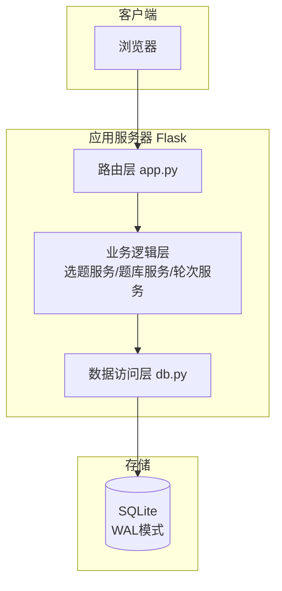
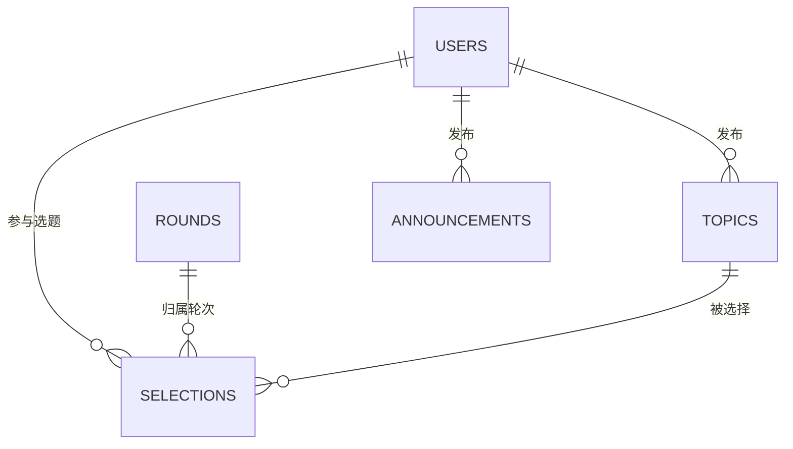

# 学生选题系统 设计报告

## 1. 概述

本报告为学生选题系统（TopicGo）的概要设计与详细设计文档，涵盖系统架构、功能模块、数据库设计、关键算法与接口设计。

### 1.1 技术选型

| 层 | 选型 | 理由 |
| --- | --- | --- |
| 后端 | Python 3.10+ / Flask 3 | 轻量、开发效率高，与课程案例技术栈一致 |
| 前端 | Jinja2 模板 + 原生 CSS | 不前后端分离，部署简单，一个 `python app.py` 即可运行 |
| 数据库 | SQLite（WAL 模式） | 零运维，支持事务，满足课程规模（百级用户） |
| 安全 | Werkzeug 密码哈希 + Session | 密码不明文存储 |

### 1.2 设计目标

1. **并发安全**：高并发选题时不超卖（事务 + 唯一约束）；
2. **规则可配**：先到先得 / 绩点优先两种模式；
3. **过程透明**：实时人数、结果公示；
4. **可追溯**：全表维护创建人/创建时间/更新人/更新时间/FLAG 五字段。

## 2. 系统架构设计

### 2.1 总体架构



### 2.2 目录结构

```
src/
├── app.py            # 应用入口与全部路由
├── db.py             # 数据库连接、建表、种子数据
├── schema.sql        # 建表脚本
├── requirements.txt
├── static/style.css
└── templates/        # Jinja2 模板
    ├── base.html / login.html
    ├── student/      # browse / mine / public
    └── teacher/      # topics / round / monitor
```

### 2.3 模块划分

| 模块 | 职责 | 主要函数 |
| --- | --- | --- |
| 认证模块 | 登录/登出/会话/菜单权限 | `login`, `logout`, `login_required` |
| 题库模块 | 题目 CRUD、筛选搜索 | `teacher_topics`, `topic_add/edit/delete` |
| 选题模块 | 选题/退选/候补/递补（核心） | `do_select`, `do_cancel` |
| 轮次模块 | 轮次设置、规则与窗口控制 | `teacher_round`, `round_save` |
| 监控模块 | 统计、CSV 导出、结果公示 | `teacher_monitor`, `export_csv`, `public_page` |

## 3. 数据库设计

### 3.1 ER 图



### 3.2 表结构（均含 CREATED_BY/CREATED_AT/UPDATED_BY/UPDATED_AT/FLAG 五字段）

**USERS 用户表**

| 字段 | 类型 | 说明 |
| --- | --- | --- |
| ID | INTEGER PK | 主键 |
| USER_NO | TEXT UNIQUE | 学号/工号 |
| USER_NAME | TEXT | 登录名 |
| PASSWORD_HASH | TEXT | 密码哈希 |
| REAL_NAME | TEXT | 姓名 |
| CLASS_NAME | TEXT | 班级 |
| GPA | REAL | 平均绩点（绩点优先规则用） |
| ROLE | TEXT | student / teacher |
| DEPT | TEXT | 所属部门 |

**TOPICS 题目表**：ID、TOPIC_CODE(编号)、TOPIC_NAME、TOPIC_DESC、TAG、DIFFICULTY、MAX_NUM(人数上限)、TEACHER_ID(发布人)、STATUS(open/closed)

**ROUNDS 选题轮次表**：ID、ROUND_NAME、RULE(first_come/gpa_priority)、START_AT、END_AT、WAITLIST_ON(0/1)、STATUS(open/closed)

**SELECTIONS 选题记录表**：ID、ROUND_ID、TOPIC_ID、USER_ID、STATUS(confirmed/waiting/cancelled)、QUEUE_NO(候补序号)、SELECTED_AT、CANCELLED_AT；唯一约束 `(ROUND_ID, USER_ID, STATUS)` 防止一轮多选

**ANNOUNCEMENTS 公告表**：ID、TITLE、CONTENT、PUBLISHED_AT

## 4. 关键算法设计

### 4.1 并发选题（防超卖）算法

```
BEGIN IMMEDIATE                     # 立即获取写锁，串行化并发请求
  查询当前 confirmed 数量 n
  IF n < MAX_NUM THEN
      INSERT INTO SELECTIONS(..., STATUS='confirmed')
      COMMIT; 返回成功
  ELSE IF 候补开启 THEN
      INSERT INTO SELECTIONS(..., STATUS='waiting', QUEUE_NO=n+1)
      COMMIT; 返回已入候补
  ELSE
      ROLLBACK; 返回已满员
```
`SELECTIONS` 上建立唯一约束 `(ROUND_ID, USER_ID, STATUS='confirmed')` 部分唯一索引，双保险防止一轮重复选题。

### 4.2 绩点优先模式判断算法

```
选题请求时：
  higher = COUNT(USERS u WHERE u.GPA > 当前用户.GPA
                 AND u.ROLE='student'
                 AND NOT EXISTS(confirmed 选题记录))
  IF higher > 0 THEN 拒绝："请等待绩点高于你的同学先选"
  ELSE 允许选题
```

### 4.3 退选递补算法

```
取消 confirmed 记录 → STATUS='cancelled'
取该题目候补队列 QUEUE_NO 最小者 → 更新为 confirmed，QUEUE_NO 置空
```

### 4.4 选题窗口校验

请求时校验 `now ∈ [START_AT, END_AT]` 且轮次 `STATUS='open'`，否则拒绝并提示。

## 5. 接口设计（主要路由）

| 方法 | 路径 | 说明 |
| --- | --- | --- |
| GET/POST | `/login` `/logout` | 登录登出 |
| GET | `/student/browse` | 题库浏览（搜索/筛选） |
| POST | `/student/select/<topic_id>` | 选题 |
| POST | `/student/cancel/<selection_id>` | 退选 |
| GET | `/student/mine` `/student/public` | 我的选题/结果公示 |
| GET/POST | `/teacher/topics` | 题库维护 |
| POST | `/teacher/topics/delete/<id>` | 删除题目 |
| GET/POST | `/teacher/round` | 轮次设置 |
| GET | `/teacher/monitor` | 选题监控 |
| GET | `/teacher/export` | 导出 CSV |

## 6. 测试要点

1. 功能：登录、浏览、选题、退选、候补递补、教师 CRUD、导出；
2. 并发：JMeter/多线程模拟 50 人同时抢 1 个名额，验证仅 1 人成功；
3. 规则：绩点优先模式下低绩点学生无法抢先。
