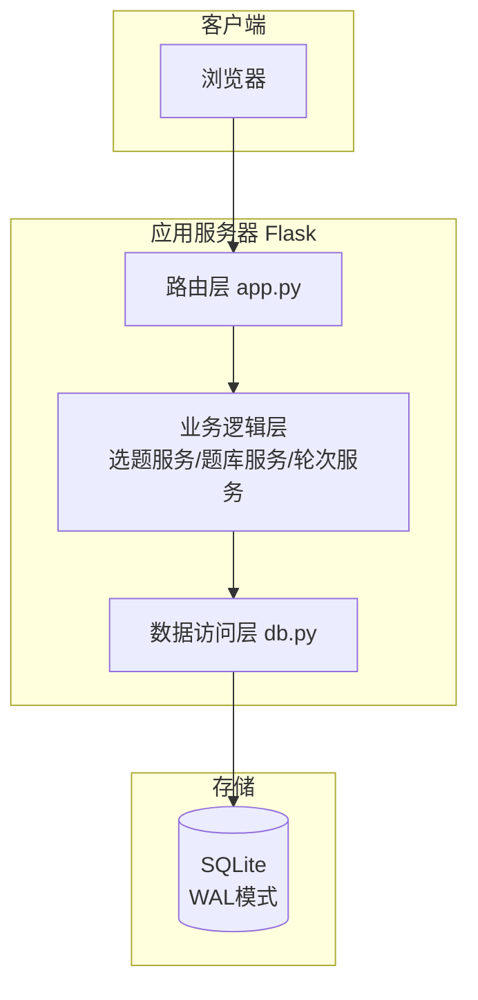
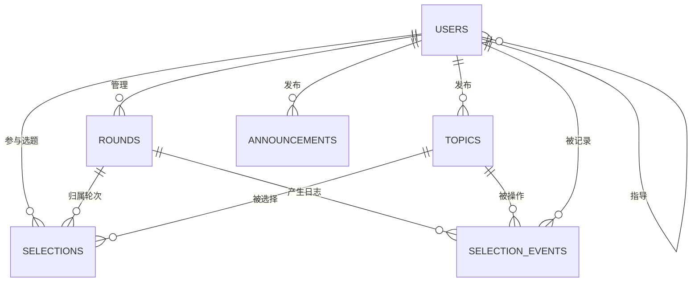

# 学生选题系统 设计报告

## 1. 概述

本报告为学生选题系统（TopicGo）的概要设计与详细设计文档，涵盖系统架构、功能模块、数据库设计、关键算法与接口设计。

### 1.1 技术选型

| 层 | 选型 | 理由 |
| --- | --- | --- |
| 后端 | Python 3.10+ / Flask 3 | 轻量、开发效率高，与课程案例技术栈一致 |
| 前端 | Jinja2 模板 + 原生 CSS | 不前后端分离，部署简单，一个 `python app.py` 即可运行 |
| 数据库 | SQLite（WAL 模式） | 零运维，支持事务，满足课程规模（百级用户） |
| 安全 | Werkzeug 密码哈希 + Session | 密码不明文存储 |

### 1.2 设计目标

1. **并发安全**：高并发选题时不超卖（事务 + 唯一约束）；
2. **规则可配**：先到先得 / 绩点优先两种模式；
3. **过程透明**：实时人数、结果公示；
4. **可追溯**：全表维护创建人/创建时间/更新人/更新时间/FLAG 五字段。

## 2. 系统架构设计

### 2.0 角色与权限模型（职责分离）

| 角色 | 职责范围 | 权限明细 |
| --- | --- | --- |
| 管理员 admin | **仅平台账户管理，不涉及课程业务** | 登记/编辑/停用/重置密码/删除用户；为分学生配指导教师。不能访问题库、轮次、监控、日志 |
| 教师 teacher | **仅管理自己的课题与自己的学生** | 发布/编辑/删除自己的课题；设置自己的选题轮次（策略/递补/志愿数/抽签种子/班级范围）；监控自己课题的选题情况；执行志愿分配/抽签/手动递补；查看自己课题的操作日志；导出自己课题的结果。不能访问用户管理，不能看到其他教师的课题 |
| 学生 student | **仅看到自己指导教师的开放课题** | 浏览（按自己老师过滤）、选题/退选、志愿填报、我的选题（含退选历史）、结果公示（仅自己老师课题） |

**数据归属**：
- `USERS.ADVISOR_ID`：学生所属指导教师，由管理员登记时分配；未分配的学生登录后看不到任何课题；
- `TOPICS.TEACHER_ID`：课题发布教师，教师只能 CRUD 自己的课题；
- `TOPICS.TARGET_CLASSES`：课题面向班级（逗号分隔），**空=面向该教师名下所有班级**；勾选后仅这些班级的学生可见；
- `ROUNDS.TEACHER_ID`：轮次归属教师，每位教师独立管理自己的选题轮次；
- 学生浏览/选题时按 `TOPICS.TEACHER_ID = 自己的 ADVISOR_ID` + `TARGET_CLASSES` 包含自己班级 + 课题 `STATUS='open'` + 老师轮次开放（时间窗内）四重过滤——**老师不开放，学生就看不到**。

**三者关系图**：

```
管理员 ──登记/分配──> 学生（ADVISOR_ID 指向唯一教师）
                          │
教师 ──管理──> 名下多个班级（由其学生的 CLASS_NAME 派生）
教师 ──发布──> 课题（TARGET_CLASSES 指定面向班级）
教师 ──设置──> 自己的选题轮次（策略/递补/时间/班级范围）
学生 ──可见──> 自己老师的课题 且 面向自己班级 且 已开放
```

**登录管控**：系统不提供公开注册，只有管理员登记的用户才能登录；被停用（STATUS=disabled）的账号登录时直接拒绝。

### 2.1 总体架构



### 2.2 目录结构

```
src/
├── app.py            # 应用入口与全部路由
├── db.py             # 数据库连接、建表、种子数据
├── schema.sql        # 建表脚本
├── requirements.txt
├── static/style.css
└── templates/        # Jinja2 模板
    ├── base.html / login.html
    ├── student/      # browse / mine / public
    └── teacher/      # topics / round / monitor
```

### 2.3 模块划分

| 模块 | 职责 | 主要函数 |
| --- | --- | --- |
| 认证模块 | 登录/登出/会话/菜单权限/账号启停校验 | `login`, `logout`, `login_required` |
| 用户管理模块 | 登记/停用/重置密码/删除、学生分配指导教师（仅管理员） | `admin_users` |
| 题库模块 | 题目 CRUD（仅自己的课题）、筛选搜索 | `teacher_topics`, `topic_add/edit/delete` |
| 选题模块 | 选题/退选/候补/志愿填报（核心） | `do_select`, `do_cancel`, `student_wish` |
| 轮次模块 | 轮次设置、策略与窗口控制 | `teacher_round`, `round_save` |
| 策略执行模块 | 多志愿分配、公开抽签、手动递补 | `teacher_allocate`, `teacher_lottery`, `teacher_manual_promote` |
| 监控模块 | 统计、CSV 导出、结果公示 | `teacher_monitor`, `export_csv`, `public_page` |
| 日志模块 | 操作日志记录与审计（仅自己课题） | `log_event`, `teacher_logs` |

## 3. 数据库设计

### 3.1 ER 图



### 3.2 表结构（均含 CREATED_BY/CREATED_AT/UPDATED_BY/UPDATED_AT/FLAG 五字段）

**USERS 用户表**

| 字段 | 类型 | 说明 |
| --- | --- | --- |
| ID | INTEGER PK | 主键 |
| USER_NO | TEXT UNIQUE | 学号/工号 |
| USER_NAME | TEXT | 登录名 |
| PASSWORD_HASH | TEXT | 密码哈希 |
| REAL_NAME | TEXT | 姓名 |
| CLASS_NAME | TEXT | 班级 |
| GPA | REAL | 平均绩点（绩点优先规则用） |
| ROLE | TEXT | student / teacher / admin |
| DEPT | TEXT | 所属部门 |
| ADVISOR_ID | INTEGER | 学生所属指导教师ID（教师/管理员为空） |
| STATUS | TEXT | active / disabled（停用后禁止登录） |

**TOPICS 题目表**：ID、TOPIC_CODE(编号)、TOPIC_NAME、TOPIC_DESC、TAG、DIFFICULTY、MAX_NUM(人数上限)、TEACHER_ID(发布人)、TARGET_CLASSES(面向班级，逗号分隔，空=所有班级)、STATUS(open/closed)

**ROUNDS 选题轮次表**：ID、ROUND_NAME、TEACHER_ID(轮次归属教师，每位教师管理自己的轮次)、RULE(first_come/gpa_priority/multi_wish/lottery)、START_AT、END_AT、WAITLIST_ON(候补开关)、PROMOTE_MODE(auto/manual/off 递补方式)、MAX_WISH(多志愿每人志愿数)、LOTTERY_SEED(抽签种子，公开可复现)、ALLOW_CLASSES(分组轮选允许班级)、STATUS(open/closed)

**SELECTIONS 选题记录表**：ID、ROUND_ID、TOPIC_ID、USER_ID、STATUS(confirmed/waiting/wish/entry/cancelled)、WISH_NO(志愿序号)、QUEUE_NO(候补序号)、SELECTED_AT、CANCELLED_AT；唯一约束 `(ROUND_ID, USER_ID) WHERE STATUS='confirmed'` 防止一轮多选。**退选不删除记录**：状态置为 cancelled 并记录 CANCELLED_AT，"选课记录"与"退选记录"都永久保留。

**SELECTION_EVENTS 操作日志表（留痕审计）**：ID、ROUND_ID、TOPIC_ID、USER_ID、ACTION(select/cancel/promote/allocate/lottery)、FROM_STATUS、TO_STATUS、WISH_NO、QUEUE_NO、OPERATOR(操作人)、REMARK(备注，如抽签种子)、OPERATED_AT。选题、退选、递补、志愿分配、抽签的每一次状态变化都追加一条不可变日志，师生可在「操作日志」页审计。

**ANNOUNCEMENTS 公告表**：ID、TITLE、CONTENT、TEACHER_ID(公告归属教师，学生只看自己老师的公告)、PUBLISHED_AT

## 4. 关键算法设计

### 4.1 并发选题（防超卖）算法

```
BEGIN IMMEDIATE                     # 立即获取写锁，串行化并发请求
  查询当前 confirmed 数量 n
  IF n < MAX_NUM THEN
      INSERT INTO SELECTIONS(..., STATUS='confirmed')
      COMMIT; 返回成功
  ELSE IF 候补开启 THEN
      INSERT INTO SELECTIONS(..., STATUS='waiting', QUEUE_NO=n+1)
      COMMIT; 返回已入候补
  ELSE
      ROLLBACK; 返回已满员
```
`SELECTIONS` 上建立唯一约束 `(ROUND_ID, USER_ID, STATUS='confirmed')` 部分唯一索引，双保险防止一轮重复选题。

### 4.2 绩点优先模式判断算法

```
选题请求时：
  higher = COUNT(USERS u WHERE u.GPA > 当前用户.GPA
                 AND u.ROLE='student'
                 AND NOT EXISTS(confirmed 选题记录))
  IF higher > 0 THEN 拒绝："请等待绩点高于你的同学先选"
  ELSE 允许选题
```

### 4.3 退选与递补算法（留痕版）

```
取消记录 → STATUS='cancelled'（不删除，CANCELLED_AT 记录时间）＋ 写 cancel 日志
按 PROMOTE_MODE 处理：
  auto   → 取该题目候补队列 QUEUE_NO 最小者递补为 confirmed ＋ 写 promote 日志
  manual → 仅记录"名额待教师手动递补"，由教师在监控页递补
  off    → 不递补
```

### 4.4 多志愿平行分配算法

```
教师点击"执行分配"（BEGIN IMMEDIATE）：
  按 WISH_NO 升序、绩点降序遍历所有 wish 记录
  该生未分配 且 题目未满 → confirmed（记 allocate 日志：第N志愿命中）
  该生已分配 → 其余 wish 记录置 cancelled（记日志：本志愿作废）
  该生未分配 且 为第一志愿 → 转 waiting 候补（记日志）
```

### 4.5 随机抽签算法（公平可审计）

```
种子 = 轮次配置的 LOTTERY_SEED（留空则按轮次自动生成，并向全员公开）
报名按 绩点降序 + ID 排序后，用 random.Random(种子).shuffle 洗牌
前 MAX_NUM 名 → confirmed，其余 → waiting（记 lottery 日志，备注含种子）
任何人获得相同种子与报名名单均可复现验证结果
```

### 4.6 分组轮选与选题窗口校验

```
选题请求时校验：
  1. now ∈ [START_AT, END_AT] 且轮次 STATUS='open'
  2. 若配置 ALLOW_CLASSES，用户班级必须在允许列表中
  3. 策略模式匹配（多志愿/抽签模式禁止直接选题）
```

## 5. 接口设计（主要路由）

| 方法 | 路径 | 说明 |
| --- | --- | --- |
| GET/POST | `/login` `/logout` | 登录登出（校验 STATUS 启停） |
| GET | `/student/browse` | 题库浏览（搜索/筛选，按模式展示） |
| GET | `/student/index` | 学生首页（待办/倒计时/进度/公告） |
| POST | `/student/select/<topic_id>` | 选题（先到先得/绩点优先/分组轮选） |
| GET/POST | `/student/wish` | 志愿填报 / 抽签报名 |
| POST | `/student/cancel/<selection_id>` | 退选（留痕 + 按策略递补） |
| GET | `/student/mine` `/student/public` | 我的选题（含退选历史）/结果公示 |
| GET/POST | `/teacher/topics` | 题库维护 |
| POST | `/teacher/topics/delete/<id>` | 删除题目 |
| GET/POST | `/teacher/round` | 轮次设置（策略/递补/志愿数/种子/班级范围） |
| GET | `/teacher/monitor` | 选题监控（含候补名单） |
| GET | `/teacher/index` | 教师工作台（待办/进度/学生选题一览） |
| GET | `/teacher/students` | 我的学生（选题进度一览） |
| GET/POST | `/teacher/announce` | 公告发布/撤回 |
| POST | `/teacher/allocate` `/teacher/lottery` | 执行志愿分配 / 公开抽签 |
| POST | `/teacher/promote/<id>` | 教师手动递补 |
| GET | `/teacher/logs` | 操作日志审计 |
| GET | `/teacher/export` | 导出 CSV |
| GET/POST | `/admin/users` | 用户管理（登记/停用/重置密码/删除） |

## 6. 测试要点

1. 功能：登录、浏览、选题、退选留痕、候补递补（自动/手动/关闭）、教师 CRUD、导出；
2. 策略：绩点优先防抢先、多志愿平行分配、抽签种子可复现、分组班级限制；
3. 权限：未登记账号拒绝登录、停用账号拒绝登录、学生/教师不能访问管理页；
4. 并发：多线程模拟 6 人同时抢 3 个名额，验证不超卖；
5. 回归：`tests/test_regression.py` 共 53 项断言全部通过（含师生归属隔离、Dashboard、公告、课题面向班级）；
6. 多用户协同：`tests/test_e2e_multi_user.py` 模拟 2 位教师 + 12 名学生跨班级共同操作，22 项断言全部通过（含并发抢课不超卖、班级隔离、退选递补、志愿分配一致性、教师数据隔离）。
