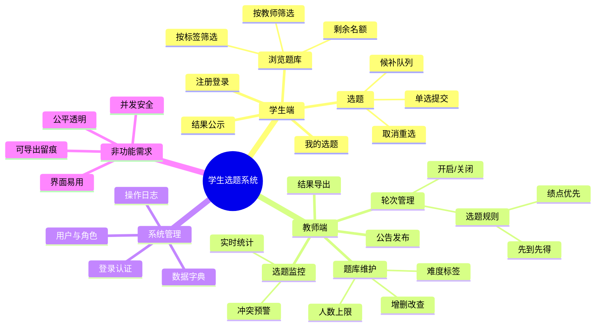

# 01 项目立项

> 本页面属于《软件工程》实践课程项目过程文档，记录小组头脑风暴会议与项目立项结论。
> 小组成员、NABCD 模型分析、选题结论均以本页为准。

---

## 一、头脑风暴会议记录

| 项目 | 内容 |
| --- | --- |
| 会议主题 | 课程课设项目选题头脑风暴 |
| 会议时间 | 2026-09-08 19:30 – 21:00 |
| 会议地点 | 图书馆研讨间 302 / 线上腾讯会议 883-xxx-xxx |
| 会议主持 | 学生1（组长） |
| 记录人 | 学生2 |

### 参会者与角色

> 本小组共 2 人，采用"全栈协同、按模块牵头"的方式分工，两人均参与开发与测试。

| 姓名 | 小组角色 | 项目角色 | 分工 |
| --- | --- | --- | --- |
| 学生1 | 组长 | 项目经理 / 后端开发 | 统筹进度、系统架构与后端逻辑（选题核心算法、权限、策略执行）、Gitee 管理、测试 |
| 学生2 | 组员 | 产品 / 前端 / 文档 | 需求分析、原型与页面开发、数据库设计协作、文档撰写、发布与用户反馈 |

### 会议议题

1. 从课程提供的选题参考中确定本组项目；
2. 明确项目要解决的核心痛点；
3. 用思维导图发散项目功能；
4. 对候选选题进行 NABCD 分析并投票。

### 头脑风暴过程（要点）

1. **候选选题罗列**：全组先从课程选题参考中圈定 3 个候选方向：
   - A：学生选题系统（解决课设选题公平与效率问题）；
   - B：儿童口算练习 App（面向小学生家长）；
   - C：P2P 分片文件下载工具（技术难度高）。
2. **可行性评估**：C 方向涉及 P2P 网络与 RS 纠删码，20 学时 + 2 人团队风险过高；B 方向竞品多、需要真实家长用户调研，时间不足。
3. **痛点共鸣**：全组同学在以往的课程课设中都遇到过"想选的题目被抢、选题顺序不透明、老师手工统计选题结果易出错"的问题，A 方向共鸣最强。
4. **结论**：确定做 **学生选题系统**，并明确两个核心场景：
   - 学生侧：题目浏览 → 按规则选题 → 查看结果；
   - 教师侧：题库维护 → 发布选题轮次 → 监控与导出结果。
5. **风险讨论**：并发选题时的"超卖"问题（剩余名额为 0 时重复提交）必须在设计阶段解决（数据库事务 + 唯一约束）。

### 会议照片

> 会议现场照片、线上会议截图已归档，见本 Wiki 页面附件：
> `meeting-photo-1.jpg`、`meeting-photo-2.jpg`、`online-meeting.png`
> （上传方式：Wiki 页面编辑 → 插入图片，或拖拽上传）

---

## 二、思维导图（Mindmap）

---

## 三、NABCD 模型分析

### N（Need 需求）

课程课设选题环节长期存在痛点：

1. **学生侧**：想选的题目总是被抢先，选题顺序不透明，"为什么他先选到我却不能选"缺乏解释；不知道自己绩点排名在选题中的实际位置。
2. **教师侧**：课设题目分散在 Excel / 微信群 / 邮件中，维护困难；选题结果需要人工汇总核对，容易出错；无法控制每题的选题人数，出现"撞题"后要反复协调。
3. **痛点的本质**：选题过程缺乏一个**公正公开、实时透明、可追溯**的在线平台。

### A（Approach 做法）

开发一个轻量级 Web 应用"学生选题系统"：

1. **题库集中管理**：教师在线上维护题目（内容、人数上限、难度标签、先修要求），一处维护、全员可见；
2. **规则化选题**：教师为每次选题配置规则——
   - **绩点优先模式**：系统按学生绩点排名依次开放选择权，高绩点学生优先锁定；
   - **先到先得模式**：选题窗口开启后实时抢选，系统通过数据库事务 + 唯一约束保证不超卖；
3. **过程透明**：题目列表实时显示已选/剩余人数；选题结束后结果全员公示，减少争议；
4. **留痕可导出**：选题记录、操作日志全部入库，教师一键导出 CSV 存档。

### B（Benefit 好处）

1. **学生**：公平地按规则选到心仪题目，减少与老师、同学的反复沟通；随时查看自己的选题状态；
2. **教师**：免去手工汇总与协调，选题结果一键导出；题目维护、人数控制全部线上化；
3. **学校/学院**：选题数据沉淀为结构化数据，为后续课程设计提供参考；系统可复用到其他课程的课设选题。

### C（Competitors 竞争）

| 竞争方式 | 现状 | 我们的优势 |
| --- | --- | --- |
| Excel + 微信群收集 | 目前最常用，易错、难统计、无实时性 | 实时锁定名额，杜绝超卖 |
| 教务系统通用选课模块 | 面向学期选课，不适配"课设选题"的一对一题目、人数上限场景 | 轻量、专门为课设选题设计，部署简单 |
| 线下现场举手选课 | 依赖时间地点，未到场学生不公平 | 线上同一窗口，规则一致 |

**主要风险**：若学校后续引入成熟的教务选课系统，本系统可能被替代。应对策略：聚焦"课设选题"细分场景，保持开源免费、可快速定制，并向其他课程推广。

### D（Delivery 推广）

1. **校内试点**：首先在《软件工程》课程课设中试用，收集师生反馈；
2. **课程组推广**：邀请本课程任课教师向软件学院其他课程组推荐；
3. **开源发布**：系统开源到 Gitee，配合项目主页（Gitee Pages）与使用说明，供其他高校直接部署使用。

### 创新点

1. **选题规则可配置**：绩点优先 / 先到先得两种模式一键切换，适配不同课程的公平性诉求；
2. **候补队列机制**：热门题目满员后自动进入候补，有人退选时按队列自动递补，提高题目利用率；
3. **选题过程全程公示**：实时人数 + 结果公示，把"暗箱操作"的空间降为零。

---

## 四、立项结论

- **项目名称**：学生选题系统（TopicGo）
- **项目目标**：为课程课设提供公正公开、实时透明、可追溯的在线选题平台；
- **技术方向**：Python + Flask + SQLite（参考课程附录案例，轻量免运维）；
- **下一步**：进入原型设计阶段（见 Wiki 页面《02 原型设计》）。
