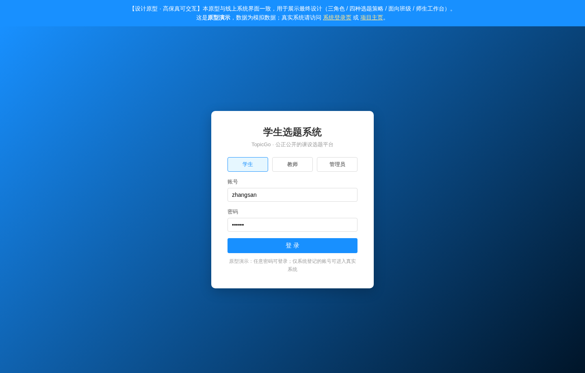
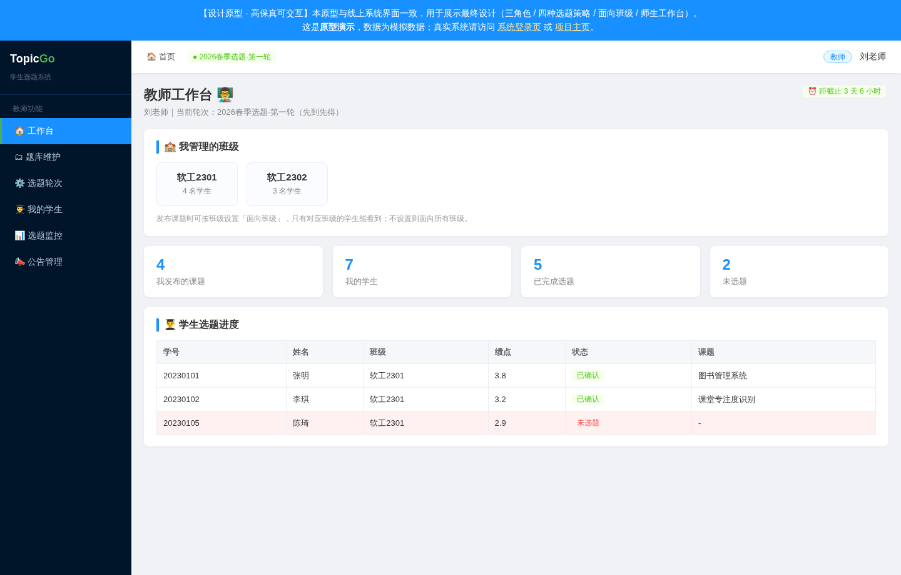
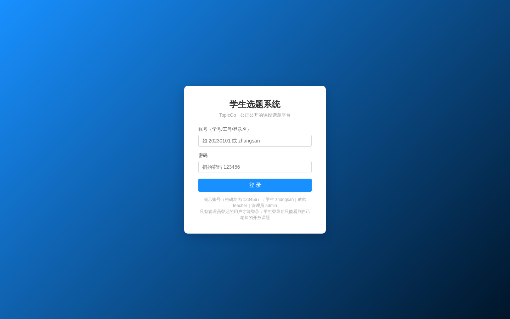
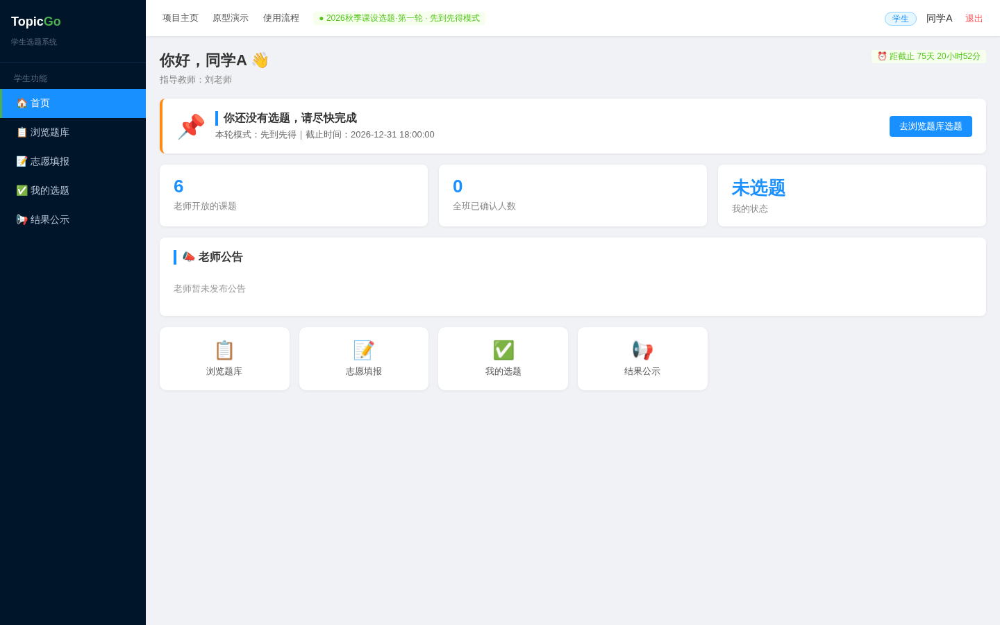
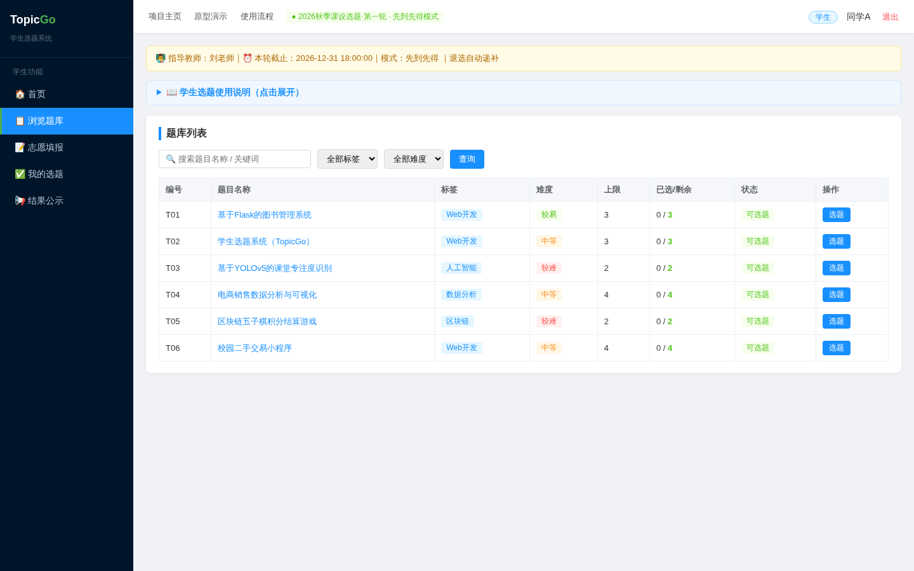
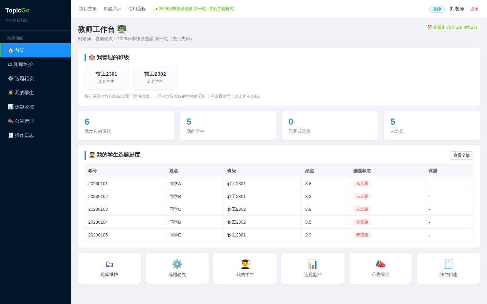
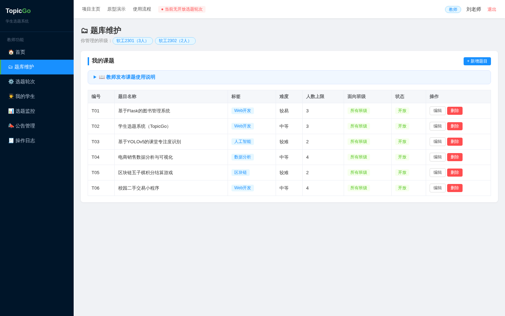
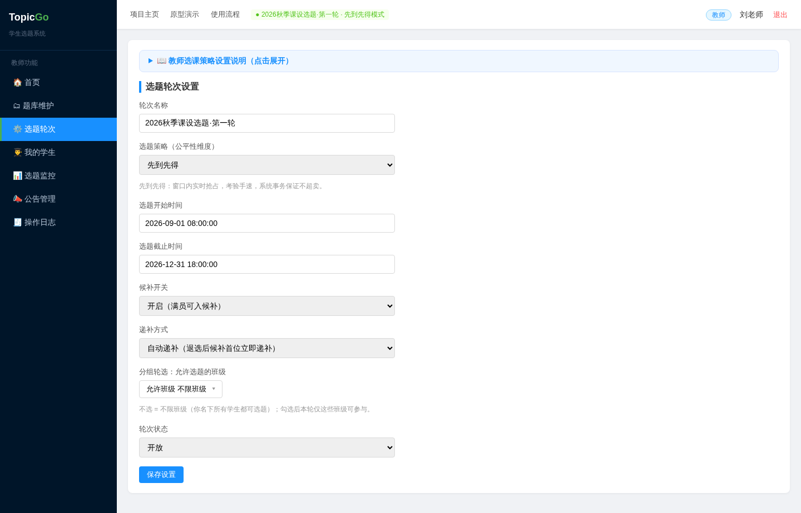
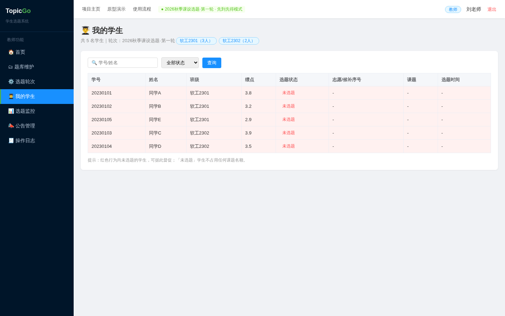
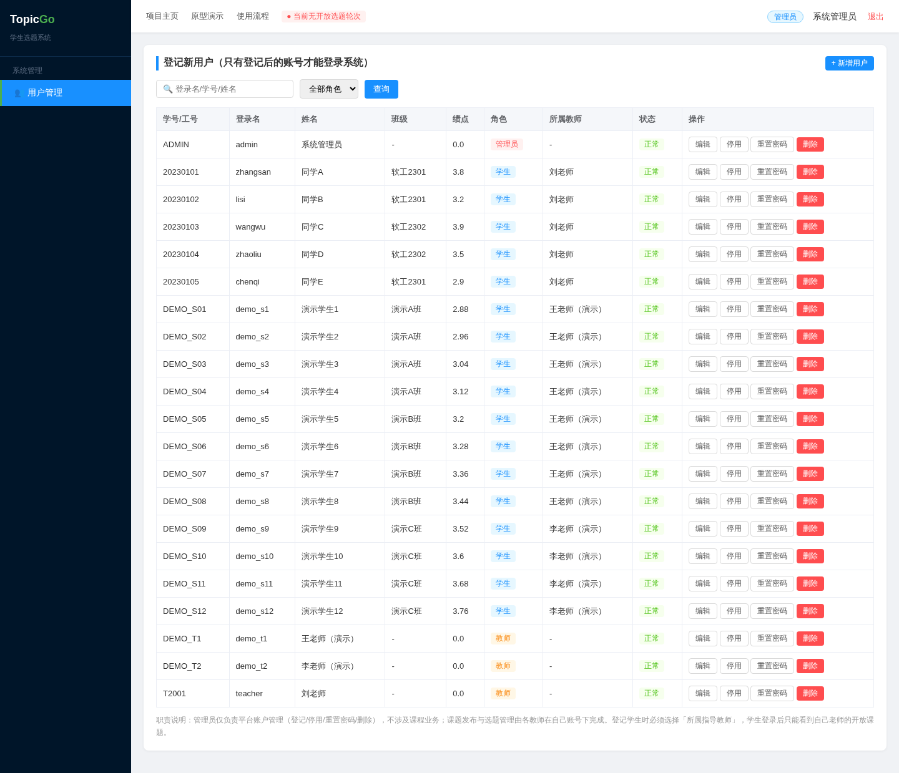

# 02 原型设计与系统界面

> 本页面包含两部分：① 高保真可交互原型 ② 线上系统真实界面截图。
> 截图由 `tests/take_screenshots.py` 自动生成（可随时重新生成，见 tests/自测说明.md）。

---

## 一、可交互原型

| 项 | 说明 |
| --- | --- |
| 在线可交互地址 | `https://<系统地址>/prototype`（系统内「原型演示」入口，无需登录） |
| 系统内入口 | 登录后点击顶部导航「原型演示」 |
| 本地打开方式 | 直接双击 `prototype/prototype.html` 用浏览器打开，无需安装环境 |

> 说明：本组原型采用 HTML 高保真可交互原型（效果等同墨刀在线原型，且可直接嵌入系统），未使用墨刀。原型覆盖三角色（学生/教师/管理员）、四种选题策略、面向班级、师生工作台，与线上系统界面一致。

### 原型截图

| 学生端原型 | 教师端原型 |
| --- | --- |
|  |  |

---

## 二、线上系统界面截图（真实截图）

> 以下截图来自运行中的系统（演示数据由 `demo_seed.py` 生成）。

### 1. 登录页


### 2. 学生首页（Dashboard：待办 / 倒计时 / 公告）


### 3. 学生端 · 浏览题库（按班级与策略展示）


### 4. 教师工作台（班级卡片 / 待办 / 学生选题进度）


### 5. 教师端 · 题库维护（面向班级多选下拉）


### 6. 教师端 · 选题轮次（四种策略 / 递补方式 / 班级范围）


### 7. 教师端 · 我的学生（选题进度一览）


### 8. 管理员 · 用户管理（登记 / 分配指导教师 / 停用）


---

## 三、重新生成截图

```bash
cd src
python app.py                                    # 启动服务
python ../tests/demo_seed.py                     # 生成演示数据（可选）
python ../tests/take_screenshots.py              # 重新生成全部截图
```

截图输出到 `wiki/screenshots/`，项目主页（`/home`）会自动引用最新截图。
