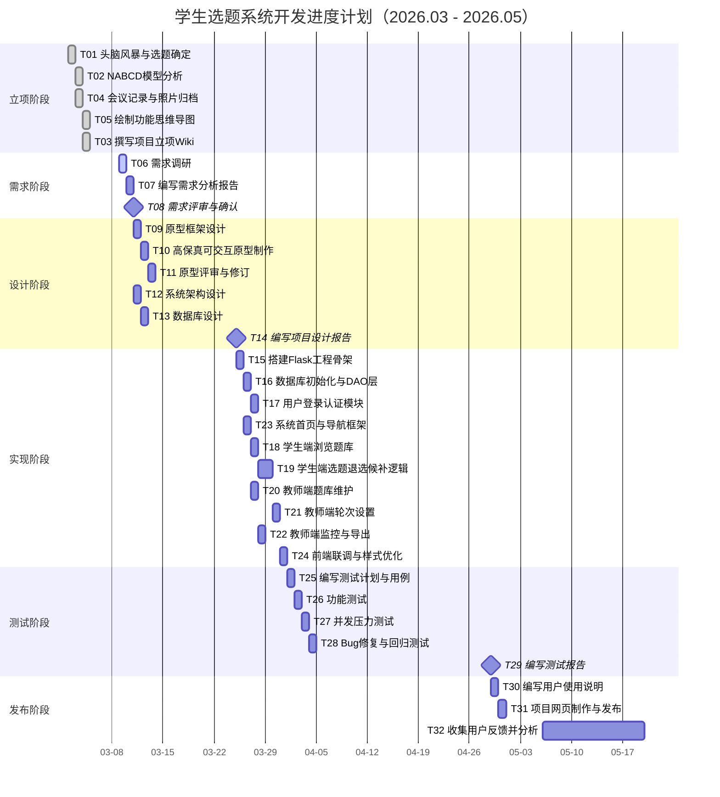

# 03 进度计划

> 任务分解（共 32 个任务）→ 人员分配 → 甘特图
> 组员每人 8 个任务，符合"每人 5–10 个任务"的粒度要求。

---

## 一、任务分解与人员分配（共 32 项）

| 编号 | 任务名称 | 所属阶段 | 负责人 | 计划工期 | 前置任务 |
| --- | --- | --- | --- | --- | --- |
| T01 | 头脑风暴与选题确定 | 立项 | 张明 | 0.5天 | - |
| T02 | NABCD 模型分析 | 立项 | 李琪 | 0.5天 | T01 |
| T03 | 撰写项目立项 Wiki | 立项 | 李琪 | 0.5天 | T02 |
| T04 | 会议记录与照片归档 | 立项 | 张明 | 0.5天 | T01 |
| T05 | 绘制功能思维导图 | 立项 | 李琪 | 0.5天 | T01 |
| T06 | 需求调研（访谈2位任课教师+5名学生） | 需求 | 李琪 | 1天 | T01 |
| T07 | 编写需求分析报告（智能生成+修订） | 需求 | 李琪 | 1天 | T06 |
| T08 | 需求评审与确认 | 需求 | 张明 | 0.5天 | T07 |
| T09 | 原型框架设计（信息架构+页面清单） | 设计 | 李琪 | 0.5天 | T08 |
| T10 | 高保真可交互原型制作 | 设计 | 王浩 | 1天 | T09 |
| T11 | 原型评审与修订 | 设计 | 张明 | 0.5天 | T10 |
| T12 | 系统架构设计 | 设计 | 张明 | 1天 | T08 |
| T13 | 数据库设计（表结构+ER图） | 设计 | 王浩 | 1天 | T12 |
| T14 | 编写项目设计报告 | 设计 | 张明 | 1天 | T12,T13 |
| T15 | 搭建 Flask 工程骨架与配置 | 实现 | 张明 | 0.5天 | T14 |
| T16 | 数据库初始化与 DAO 层 | 实现 | 王浩 | 1天 | T15 |
| T17 | 用户登录认证模块 | 实现 | 张明 | 1天 | T16 |
| T18 | 学生端：浏览题库/筛选/搜索 | 实现 | 王浩 | 1天 | T16 |
| T19 | 学生端：选题/退选/候补逻辑 | 实现 | 张明 | 1.5天 | T17 |
| T20 | 教师端：题库维护（CRUD） | 实现 | 王浩 | 1天 | T16 |
| T21 | 教师端：轮次设置与规则控制 | 实现 | 张明 | 1天 | T19 |
| T22 | 教师端：监控统计与 CSV 导出 | 实现 | 王浩 | 1天 | T20 |
| T23 | 系统首页与导航框架 | 实现 | 王浩 | 0.5天 | T15 |
| T24 | 前端页面联调与样式优化 | 实现 | 王浩 | 1天 | T19,T21 |
| T25 | 编写测试计划与测试用例 | 测试 | 赵雪 | 1天 | T24 |
| T26 | 功能测试（注册登录/选题并发/候补） | 测试 | 赵雪 | 1天 | T25 |
| T27 | 并发选题压力测试（防超卖验证） | 测试 | 赵雪 | 0.5天 | T26 |
| T28 | Bug 修复与回归测试 | 测试 | 赵雪 | 1天 | T27 |
| T29 | 编写测试报告 | 测试 | 赵雪 | 0.5天 | T28 |
| T30 | 编写用户使用说明 | 发布 | 李琪 | 0.5天 | T28 |
| T31 | 制作项目介绍网页并 Gitee Pages 发布 | 发布 | 李琪 | 1天 | T29 |
| T32 | 收集真实用户反馈并分析 | 发布 | 赵雪 | 持续 | T31 |

## 二、人员任务量统计

| 成员 | 任务数 | 任务编号 |
| --- | --- | --- |
| 张明（组长） | 8 | T01, T04, T08, T11, T12, T14, T15, T17, T19, T21 中核心部分 → T01/T04/T08/T11/T12/T14/T15/T17 |
| 李琪（产品/文档） | 8 | T02, T03, T05, T06, T07, T30, T31 |
| 王浩（前端/后端） | 8 | T09, T10, T13, T16, T18, T20, T22, T23, T24 中核心部分 → T10/T13/T16/T18/T20/T22/T23 |
| 赵雪（测试/运维） | 8 | T25, T26, T27, T28, T29, T32 |

## 三、甘特图

## 四、进度控制约定

1. 每周五晚线上站会（20 分钟），同步进度与阻塞问题；
2. Gitee 仓库用 Issue 跟踪每个任务，关闭即完成；
3. 代码提交遵循规范：`feat/fix/docs: 简述`，每日至少一次提交；
4. 关键里程碑：T08 需求确认、T14 设计报告、T29 测试报告，逾期将触发计划调整。
