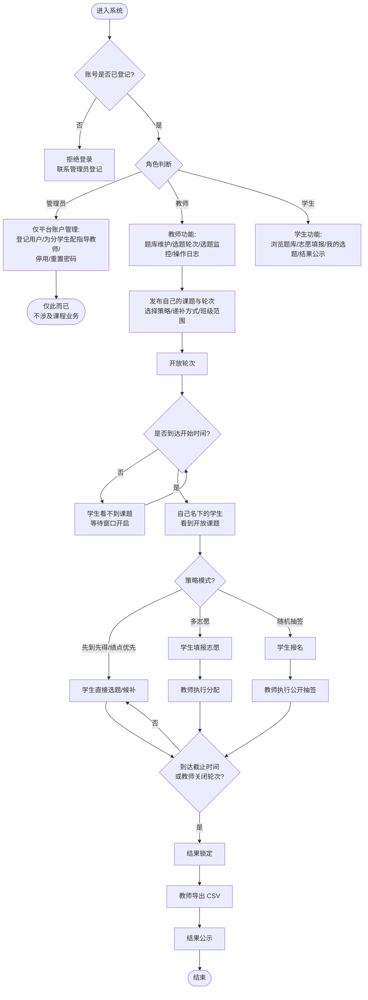
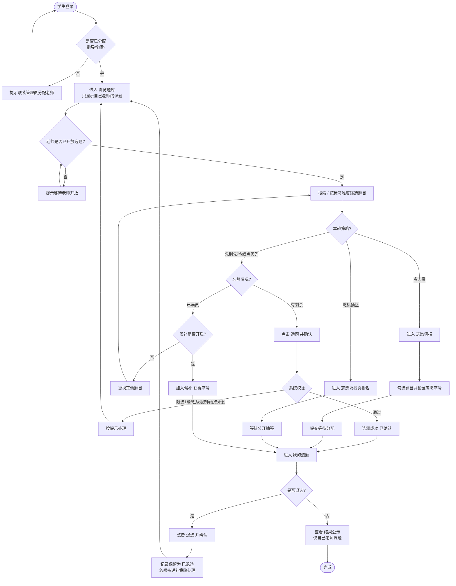
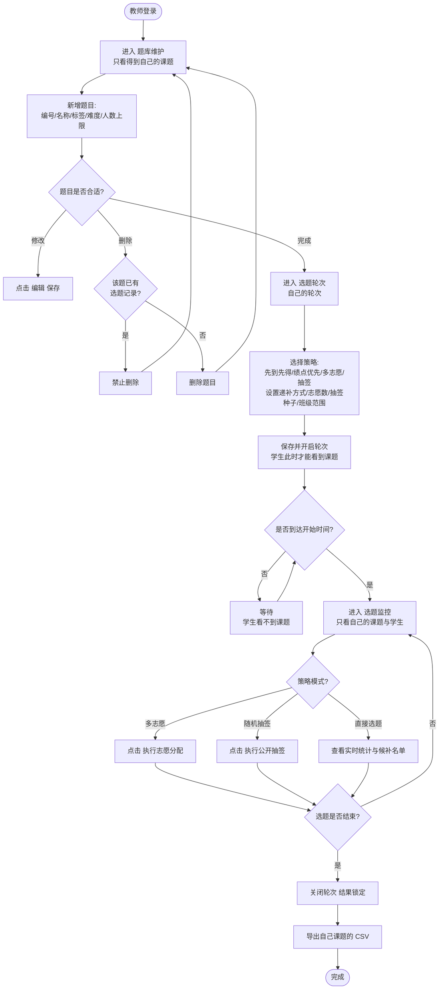
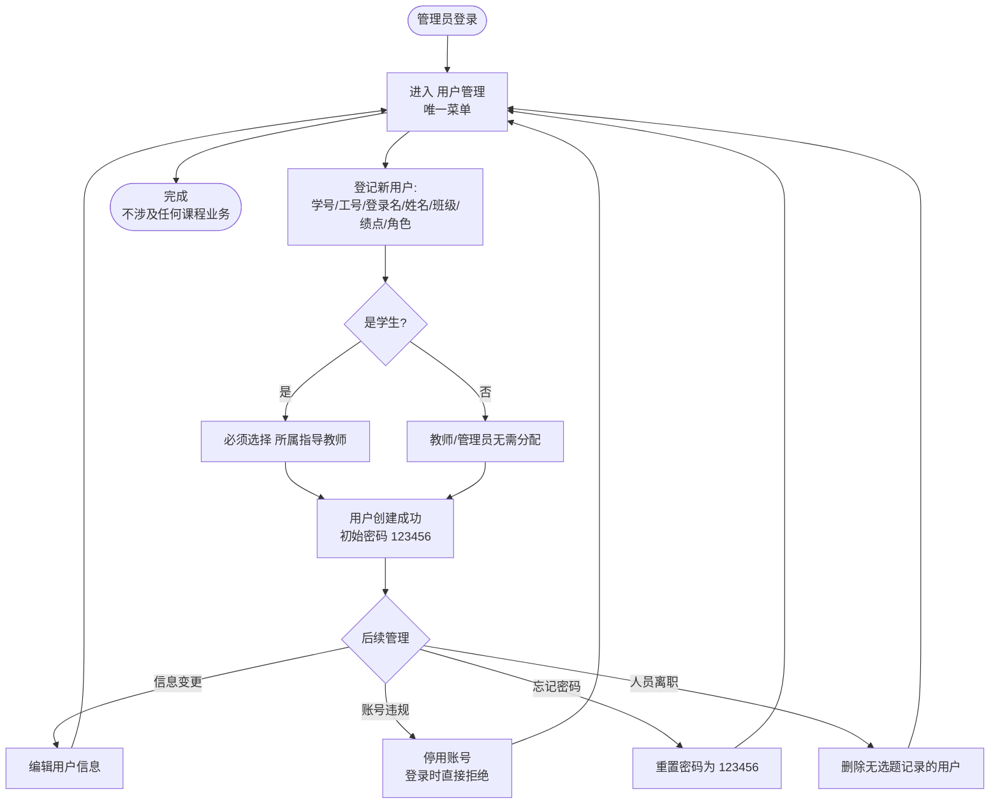
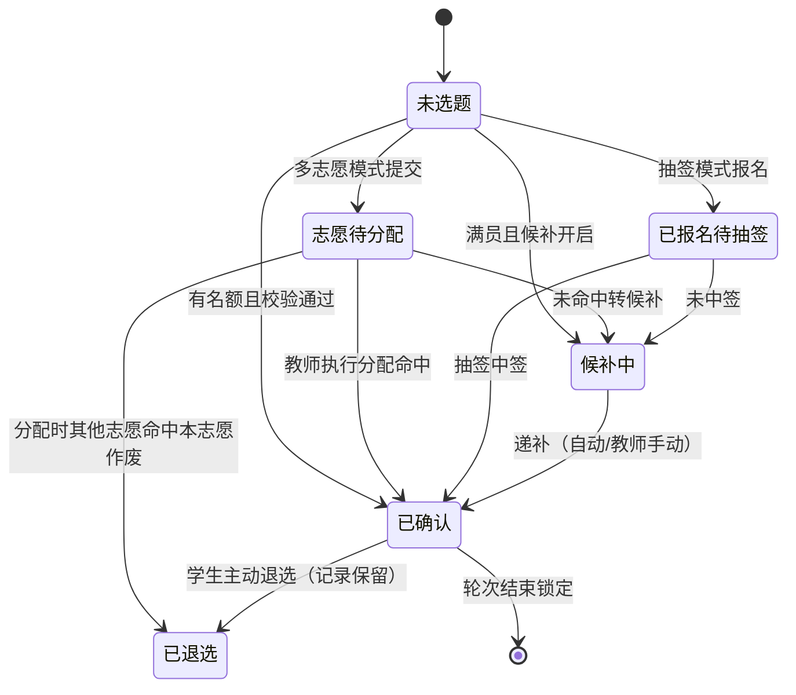

# 06 软件使用流程

> 本文档用流程图说明学生选题系统（TopicGo）的完整操作流程，供使用者快速上手。

## 〇、四种选课策略一览（教师在「选题轮次」中选择）

| 策略 | 适用场景 | 公平性机制 |
| --- | --- | --- |
| 先到先得 | 希望快速完成选题 | 事务锁防超卖，拼手速但机会均等 |
| 绩点优先 | 希望激励学业表现 | 按绩点排名依次放行，高绩点先选 |
| 多志愿分配 | 热门题目竞争激烈 | 平行志愿统一分配，同志愿超员按绩点优先 |
| 随机抽签 | 完全运气公平 | 公开种子随机抽签，**任何人可复现验证** |

辅助维度：**递补方式**（自动/教师手动/不递补）、**分组轮选**（仅允许指定班级在指定轮次选题）。

## 一、总体流程

## 二、学生操作流程

## 三、教师操作流程

## 四、管理员操作流程（仅平台账户，不涉及课程）

## 五、选题状态机

## 六、常见操作速查

| 我想… | 操作路径 |
| --- | --- |
| 看看有哪些题目 | 学生端 → 浏览题库（只能看到自己老师的开放课题） |
| 先到先得模式选课 | 浏览题库 → 点"选题" → 确认 |
| 满员的题目还想选 | 点"加入候补"，等待递补 |
| 多志愿模式选课 | 学生端 → 志愿填报 → 勾选题目、设置志愿序号 → 提交 |
| 抽签模式选课 | 学生端 → 志愿填报 → 勾选报名 → 等教师抽签 |
| 换一个题目 | 我的选题 → 退选 → 重新选题（退选记录保留） |
| 看大家都选了什么 | 学生端 → 结果公示（仅自己老师课题） |
| 加一道题目 | 教师端 → 题库维护 → "+ 新增题目"（仅自己的课题） |
| 改选课策略/时间 | 教师端 → 选题轮次 → 修改后保存 |
| 看实时选题情况 | 教师端 → 选题监控（仅自己的课题与学生） |
| 执行志愿分配/抽签 | 教师端 → 选题监控 → 对应按钮 |
| 下载选题结果 | 教师端 → 选题监控 → "导出 CSV"（仅自己的课题） |
| 审查谁选过/退过 | 教师端 → 操作日志（仅自己课题相关） |
| 登记新用户/分配老师/停用账号 | 管理员 → 用户管理 |

## 七、注意事项

1. **每人限选 1 题**，选题后想更换必须先退选；退选记录永久保留，双方都可在日志中核查；
2. 退选后名额按轮次设置的**递补方式**处理（自动递补 / 教师手动递补 / 不递补）；
3. 绩点优先模式下，系统按绩点依次放行，被拒绝时请等待高绩点同学先选；
4. 多志愿模式每人最多填教师设定的志愿数，分配时按志愿顺序 + 绩点优先；
5. 抽签模式的种子会向全员公开，任何人都能用种子复现验证结果；
6. **只有管理员登记的用户才能登录**；账号被停用后请联系管理员；
7. **学生只能看到自己指导教师的开放课题**；老师未开放轮次前题目不可见；
8. 教师只能管理自己的课题，看不到其他教师的题目与学生；
9. 已有选题记录的题目教师不能删除，只能关闭或修改人数上限。
