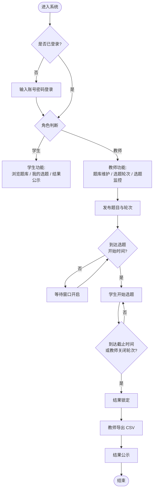
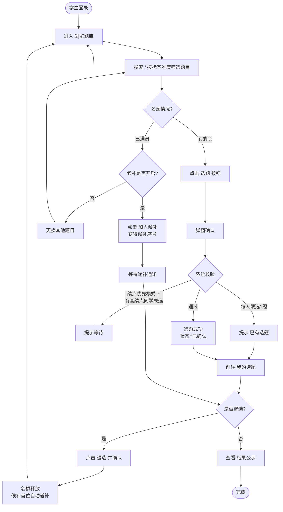
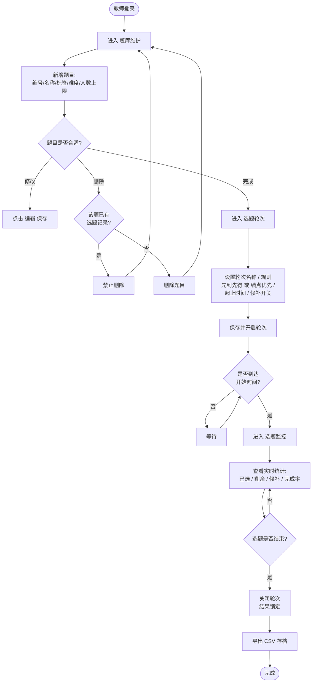
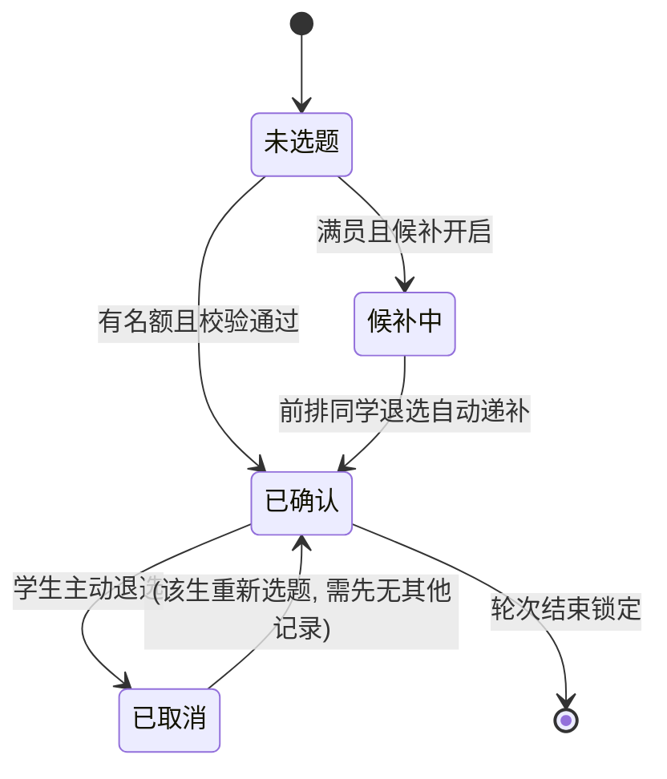

# 06 软件使用流程

> 本文档用流程图说明学生选题系统（TopicGo）的完整操作流程，供使用者快速上手。

## 一、总体流程

## 二、学生操作流程

## 三、教师操作流程

## 四、选题状态机

## 五、常见操作速查

| 我想… | 操作路径 |
| --- | --- |
| 看看有哪些题目 | 学生端 → 浏览题库（支持搜索/筛选） |
| 选一个题目 | 浏览题库 → 点"选题" → 弹窗确认 |
| 满员的题目还想选 | 点"加入候补"，等待自动递补 |
| 换一个题目 | 我的选题 → 退选 → 重新浏览选题 |
| 看大家都选了什么 | 学生端 → 结果公示 |
| 加一道题目 | 教师端 → 题库维护 → "+ 新增题目" |
| 改选题规则/时间 | 教师端 → 选题轮次 → 修改后保存 |
| 看实时选题情况 | 教师端 → 选题监控 |
| 下载选题结果 | 教师端 → 选题监控 → "导出 CSV" |

## 六、注意事项

1. **每人限选 1 题**，选题后想更换必须先退选；
2. 退选后名额会**自动递补**给候补队列第一位同学，请谨慎操作；
3. 只有在轮次开放且处于起止时间内才能选题，否则系统提示"当前不在选题窗口期"；
4. 绩点优先模式下，系统会按绩点依次放行，被拒绝时请等待高绩点同学先选；
5. 已有选题记录的题目教师不能删除，只能关闭或修改人数上限。
